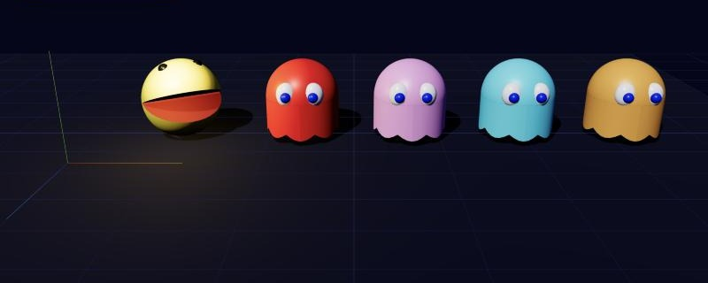
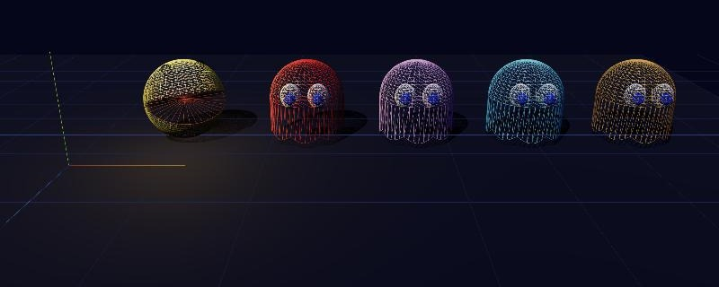
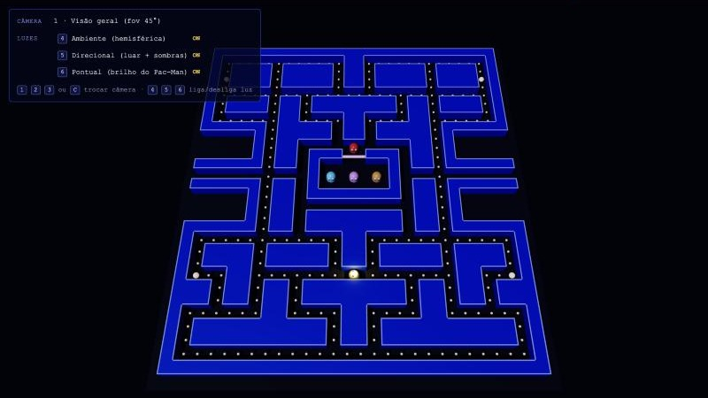

# Relatório — Entrega 02: Modelagem 3D e construção inicial da cena

**Projeto:** Pac-Man 3D
**Tecnologia:** Three.js r160 (WebGL), com HTML e módulos ES, sem etapa de build
**Commits desta etapa:** `9c07514` (estrutura), `4651e08` (cenário), `e7c6700` (modelos)

## 1. Como executar

```bash
cd CgGame
python3 -m http.server 8000
```

Abra `http://localhost:8000` para ver a cena completa e `http://localhost:8000/modelos.html` para ver a vitrine dos modelos. É preciso ter internet, porque o three.js é carregado de um CDN.

## 2. Personagens modelados

Os dois personagens foram criados pelo grupo diretamente em código (modelagem procedural), combinando primitivas do three.js. **Não foi usado nenhum modelo externo.**




### Pac-Man (`src/models/Pacman.js`)

O Pac-Man é o personagem complexo. Ele tem 6 malhas de 3 tipos de primitiva, organizadas em uma hierarquia de grupos:

```
Pac-Man (Group)                ← posição no labirinto e rotação em Y (para onde olha)
└── corpo (Group, y = raio)    ← eleva o personagem para apoiar no chão
    ├── mandíbula superior (Group, rotação +0,4 rad em Z)
    │   ├── hemisfério superior — SphereGeometry parcial (θ de 0 a π/2)
    │   ├── tampa — CircleGeometry (interior da boca)
    │   └── 2 olhos — SphereGeometry (r = 0,06)
    └── mandíbula inferior (Group, rotação −0,4 rad em Z)
        ├── hemisfério inferior — SphereGeometry parcial (θ de π/2 a π)
        └── tampa — CircleGeometry
```

- A esfera de raio 0,45 é dividida em dois hemisférios com os parâmetros de ângulo da `SphereGeometry`. Cada metade é uma mandíbula.
- A boca abre girando as mandíbulas em sentidos opostos em torno do eixo Z, que funciona como dobradiça. Com isso o modelo já fica pronto para a animação de "comer": basta variar um ângulo.
- As tampas (`CircleGeometry`, vermelho escuro, dupla face) fecham cada hemisfério. Assim o interior oco da esfera não aparece quando a boca está aberta.

### Fantasmas (`src/models/Ghost.js`)

Cada fantasma tem 6 malhas:

- **Cúpula:** meia `SphereGeometry` de raio 0,42.
- **Corpo:** `CylinderGeometry` aberto, com 48 segmentos radiais. Os vértices da borda inferior são deslocados em Y pela função `0,07 · (1 − |cos 4θ|)`, o que forma as 8 pontas da "saia". Depois as normais são recalculadas com `computeVertexNormals()`.
- **Olhos:** esferas brancas escaladas em (1; 1,2; 0,8), que viram elipsoides, mais pupilas azuis.

A mesma função gera os quatro fantasmas, mudando só a cor: Blinky (vermelho), Pinky (rosa), Inky (ciano) e Clyde (laranja).

## 3. Cena inicial (`src/scene/Maze.js`)



O labirinto é descrito como texto em `src/config.js`: 28 × 31 células, igual ao arcade. A classe `Maze` percorre esse mapa e monta:

| Elemento | Geometria | Quantidade |
|---|---|---|
| Chão | `PlaneGeometry` 30 × 33 | 1 |
| Paredes | `BoxGeometry` 1 × 1 × 1 em `InstancedMesh` | 488 blocos (1 draw call) |
| Bordas claras no topo das paredes | `BoxGeometry` fina em `InstancedMesh` | 732 faixas |
| Porta da casa dos fantasmas | `BoxGeometry` | 2 |
| Pastilhas | `SphereGeometry` r = 0,1 em `InstancedMesh` | 240 |
| Pastilhas de poder | `SphereGeometry` r = 0,24 | 4 |

O Pac-Man aparece na posição inicial do arcade, abaixo da casa dos fantasmas. Blinky fica na saída da casa e os outros três dentro dela.

## 4. Posições, escalas e orientações

- **Sistema de coordenadas:** Y aponta para cima e o labirinto fica no plano XZ, centralizado na origem. **1 unidade = 1 célula do labirinto.** A função `Maze.toWorld(col, linha)` converte a posição na grade em coordenadas do mundo: `x = col − 28/2 + 0,5` e `z = linha − 31/2 + 0,5`.
- **Escalas coerentes entre si:** as paredes têm altura 1. O Pac-Man tem diâmetro 0,9 e cabe no corredor de largura 1. Os fantasmas têm diâmetro 0,84 e as pastilhas 0,2. Todos os personagens apoiam no chão (y = 0).
- **Orientação:** a frente do Pac-Man é o eixo +X local. Na cena, `rotation.y = π` faz ele olhar para a esquerda, como no início do jogo original. Os fantasmas têm a frente em +Z.
- **Conferência visual:** a vitrine (`modelos.html`) mostra os personagens sobre uma grade de 1 unidade, com os eixos X (vermelho), Y (verde) e Z (azul).

## 5. Principais dificuldades

1. **Interior do Pac-Man aparecendo.** Ao abrir a boca, a esfera dividida mostrava o lado de dentro, vazio. A solução foi fechar cada hemisfério com um disco (`CircleGeometry`) que serve de interior da boca.
2. **Saia ondulada dos fantasmas.** Em vez de modelar vértice por vértice, deslocamos de forma procedural a borda inferior de um cilindro aberto. Foi preciso recalcular as normais para a iluminação ficar correta e usar material de dupla face, porque o cilindro não tem tampa.
3. **Desempenho com muitas paredes.** São 488 blocos de parede. Criar um `Mesh` para cada um geraria centenas de draw calls, então usamos `InstancedMesh`: uma geometria, várias matrizes de transformação.
4. **Converter a grade para o mundo.** Foi preciso centralizar o labirinto, somar 0,5 para colocar cada objeto no centro da sua célula e tratar posições "entre células", como a do Pac-Man na coluna 13,5.
5. **Executar o projeto.** Módulos ES não funcionam abrindo o arquivo direto (`file://`) por causa do CORS. Por isso o projeto precisa de um servidor local.

## 6. O que ainda falta implementar

- Movimentação do Pac-Man pelo teclado, com colisão contra as paredes
- Animações: boca abrindo e fechando, fantasmas flutuando
- Inteligência artificial dos fantasmas
- Comer pastilhas, pontuação, vidas e fim de fase
- Câmeras e iluminação (Entrega 03) e texturas (Entrega 04)
- Sons e telas de início e de fim de jogo
