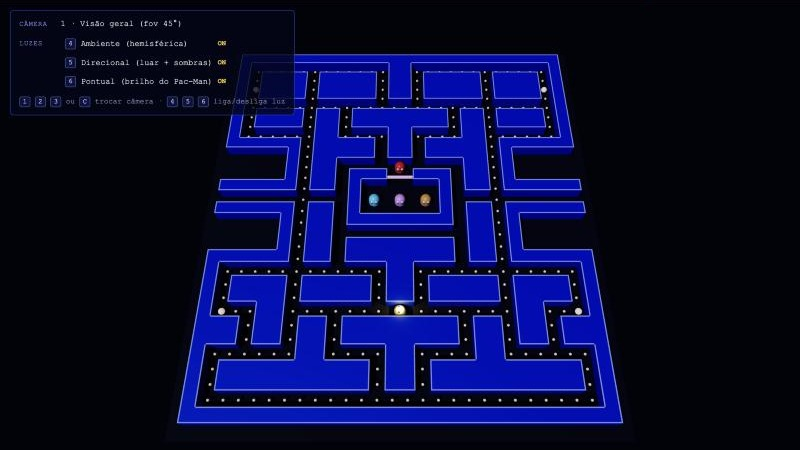
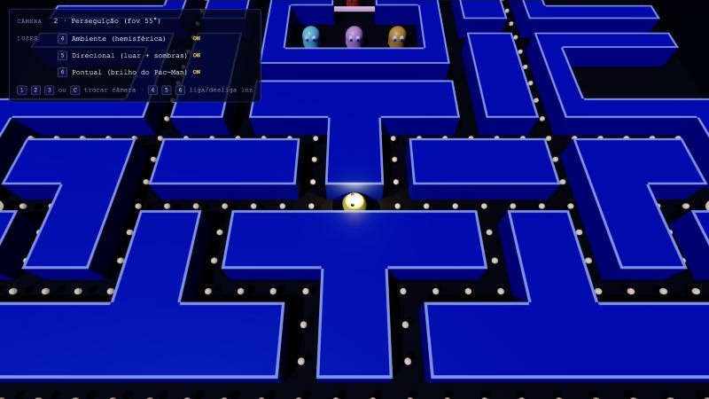
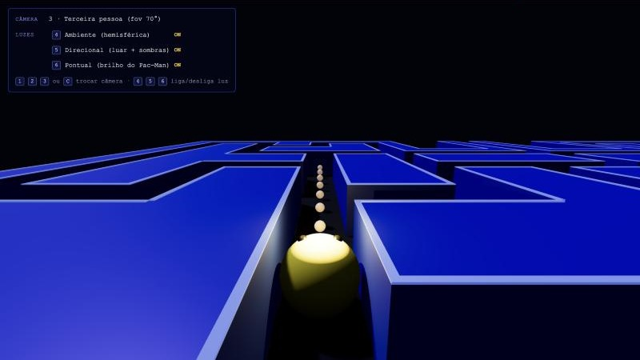
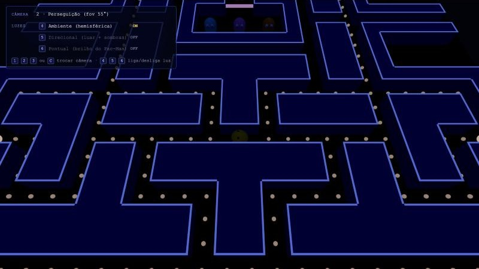
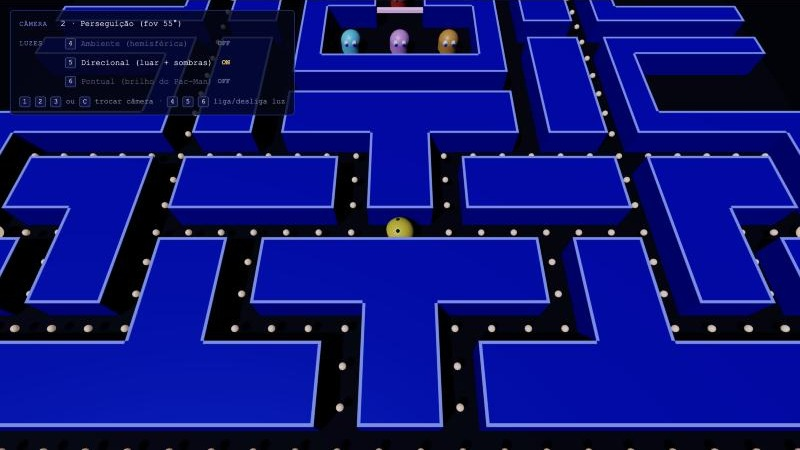
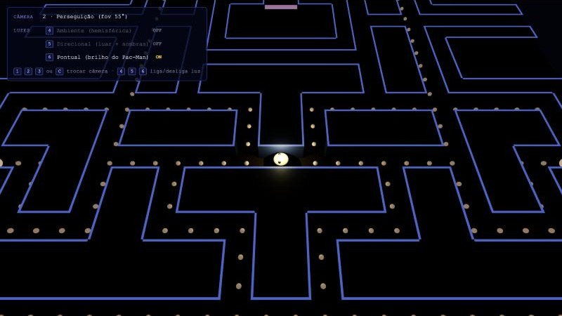
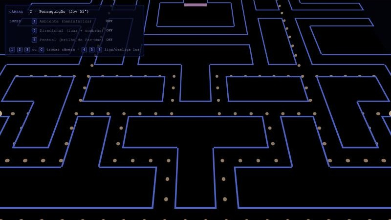

# Relatório — Entrega 03: Câmeras, projeção perspectiva e iluminação

**Projeto:** Pac-Man 3D
**Tecnologia:** Three.js r160 (WebGL), com HTML e módulos ES, sem etapa de build
**Como executar:** `python3 -m http.server 8000` na pasta do projeto e abrir `http://localhost:8000`

## 1. Evolução em relação à Entrega 02

Na Entrega 02 a cena tinha uma câmera e uma luz provisórias, escritas direto no `main.js`: uma `PerspectiveCamera` fixa e uma `HemisphereLight` forte, só para enxergar os modelos. Nesta entrega:

| | Entrega 02 | Entrega 03 |
|---|---|---|
| Cena e modelos | Labirinto, pastilhas, Pac-Man e 4 fantasmas | Os mesmos modelos, integrados sem mudança de geometria |
| Câmeras | 1 câmera fixa provisória | **3 câmeras** em `src/scene/Cameras.js`, alternáveis pelo teclado |
| Projeção | Calculada internamente pelo three.js | **Matriz de projeção montada explicitamente** em `perspectiveMatrix()` |
| Luzes | 1 luz hemisférica provisória | **3 fontes de tipos diferentes** em `src/scene/Lights.js`, cada uma liga e desliga |
| Sombras | Não havia | Mapas de sombra na luz direcional e na pontual |
| Interface | Não havia | Painel mostrando a câmera ativa e o estado de cada luz |

Commits desta etapa: `84081fc` (câmeras), `59776ae` (iluminação), `87d71ab` (enquadramento), `6dd7e45` (README) e as correções e capturas posteriores.

## 2. Cena 3D

A cena continua com os elementos da Entrega 02: labirinto 28 × 31 com chão, 488 blocos de parede, porta da casa dos fantasmas, 240 pastilhas e 4 pastilhas de poder, o Pac-Man na posição inicial e os quatro fantasmas na casa. O ambiente segue a proposta do jogo: um labirinto noturno com paredes azuis e bordas brilhantes, como no arcade.

## 3. Câmeras

Todas as câmeras usam projeção perspectiva (`PerspectiveCamera`). Cada uma tem seu próprio campo de visão e planos near/far, e portanto sua própria matriz de projeção.

| Tecla | Câmera | fov | near / far | Posição |
|---|---|---|---|---|
| `1` | Visão geral | 45° | 0,5 / 200 | Fixa, alta e inclinada, enquadra o labirinto inteiro. Afasta-se em telas estreitas. |
| `2` | Perseguição | 55° | 0,5 / 200 | 12 unidades acima e 6,5 atrás do Pac-Man, olhando para ele |
| `3` | Terceira pessoa | 70° | 0,05 / 100 | 2,6 atrás do Pac-Man e 2,1 acima, olhando 7 unidades à frente, na direção em que ele está virado |

`C` passa para a próxima câmera. A posição e a orientação (matriz de visualização) da câmera ativa são recalculadas a cada quadro em `CameraSystem.update()`. As câmeras 2 e 3 já seguem o Pac-Man e vão acompanhá-lo quando ele se mover.





## 4. Projeção perspectiva

**Onde a matriz é definida:** em `src/scene/Cameras.js`, na função `perspectiveMatrix(fov, aspect, near, far)`:

```
        | f/aspect  0         0                       0                     |
  P  =  | 0         f         0                       0                     |
        | 0         0   (far+near)/(near−far)   2·far·near/(near−far)       |
        | 0         0        −1                       0                     |

  onde f = 1 / tan(fov / 2)
```

**Onde é atribuída:** em `applyProjection(camera)`, no mesmo arquivo. Ela copia `P` para `camera.projectionMatrix` e calcula a inversa. A função é chamada ao criar cada câmera e em `setAspect()`, quando a janela é redimensionada.

**Onde é aplicada:** em `renderer.render(scene, cameras.camera)`, no loop de `src/main.js`. O three.js envia `camera.projectionMatrix` ao shader de vértices como o uniform `projectionMatrix`, e cada vértice é transformado por `gl_Position = projectionMatrix * modelViewMatrix * vec4(position, 1.0)`.

**Efeito sobre objetos próximos e distantes:** o `−1` na última linha de `P` copia a profundidade do ponto para a coordenada `w`. Na divisão perspectiva (`x/w`, `y/w`), pontos mais distantes são divididos por um valor maior e aparecem menores. Na câmera 3 isso fica bem visível: as pastilhas do corredor diminuem com a distância, as paredes convergem para um ponto de fuga e o Pac-Man, perto da câmera, parece bem maior que os outros objetos.

## 5. Fontes de luz

| Tecla | Fonte | Tipo three.js | Cor e intensidade | Papel na cena |
|---|---|---|---|---|
| `4` | Ambiente | `HemisphereLight` | Azulada de cima, arroxeada de baixo; 0,35 | Preenchimento suave, sem direção |
| `5` | Direcional ("luar") | `DirectionalLight` | Branco-azulada; 2,4; posição (−10, 24, 12) | Ilumina o labirinto todo com raios paralelos e projeta sombras (mapa 2048²) |
| `6` | Pontual (brilho do Pac-Man) | `PointLight` | Amarela; 14; alcance 9; decaimento 2 | Presa ao Pac-Man e o acompanha. Ilumina só a vizinhança dele e também projeta sombras |

Cada luz liga e desliga individualmente pelas teclas ou clicando no painel. As capturas abaixo usam a câmera 2 com uma luz de cada vez:

| Só ambiente | Só direcional | Só pontual | Todas desligadas |
|---|---|---|---|
|  |  |  |  |

- **Só ambiente:** a cena fica escura e azulada, sem direção nem sombras. As faces de cima e de lado das paredes têm quase o mesmo tom.
- **Só direcional:** o topo das paredes fica bem mais claro que as laterais, o que dá a sensação de volume, e aparecem as sombras.
- **Só pontual:** apenas a região em volta do Pac-Man é iluminada, em amarelo. A intensidade cai com o quadrado da distância.
- **Todas desligadas:** sobram só as bordas das paredes e as pastilhas, que têm um leve brilho próprio (material emissivo, não é uma fonte de luz).

## 6. Roteiro da demonstração

1. Abrir o projeto na câmera 1 e mostrar a cena completa.
2. Apertar `2` e `3` para mostrar a troca de ponto de vista. Na câmera 3, mostrar as pastilhas diminuindo com a distância.
3. Abrir `src/scene/Cameras.js` e mostrar `perspectiveMatrix()` e `applyProjection()`.
4. Voltar à câmera 2 e desligar `4`, `5` e `6` uma de cada vez, depois religar, para mostrar a contribuição de cada luz.

## 7. Dificuldades

1. **Equilíbrio entre as luzes.** Com a luz ambiente forte (0,7), desligar a direcional quase não mudava a imagem. Reduzimos a ambiente para 0,35 e aumentamos a direcional para 2,4, para que cada fonte tenha um efeito visível.
2. **Unidades das luzes pontuais.** No three.js r160 as luzes são fisicamente baseadas (intensidade em candela, decaimento quadrático). Valores pequenos quase não iluminavam, então foi preciso aumentar a intensidade da luz do Pac-Man para 14.
3. **Enquadramento.** Na primeira versão, a câmera de perseguição deixava o Pac-Man atrás das paredes e, na terceira pessoa, o próprio personagem tapava o corredor. Também foi preciso afastar a visão geral, que cortava o labirinto em telas largas (16:9).
4. **"Acne" de sombra.** Nos fantasmas, que têm superfícies curvas e de dupla face, apareciam listras de autossombreamento. Foi corrigido com `shadow.normalBias`.
5. **Manter a matriz própria.** Como a matriz de projeção é montada por nós, não podemos chamar `camera.updateProjectionMatrix()`, que a sobrescreveria. O redimensionamento da janela passa por `setAspect()`, que reaplica a nossa matriz.

## 8. Próximos passos

- Entrega 04: aplicar texturas e materiais aos personagens e ao cenário, mantendo estas três fontes de luz.
- Depois: movimentação, colisões, inteligência artificial dos fantasmas e pontuação.
