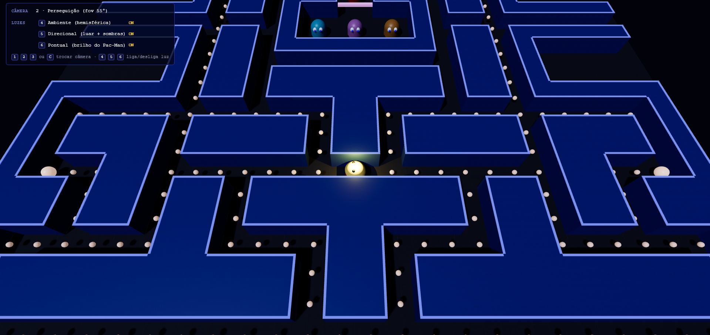
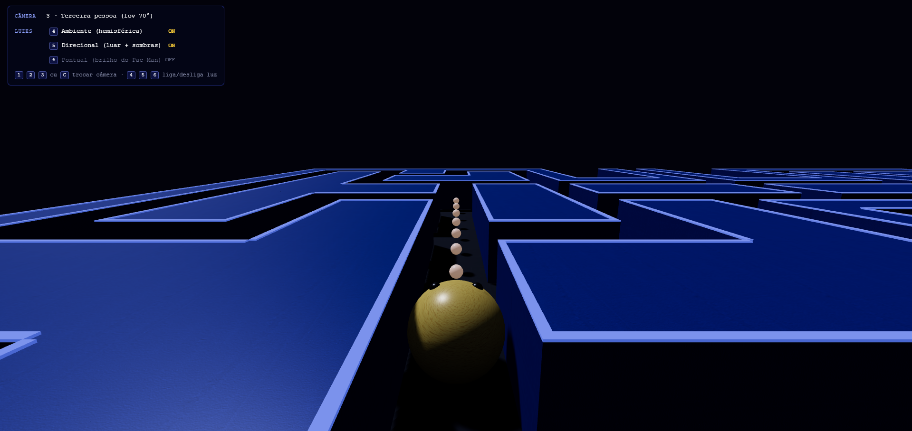

# Relatório — Entrega 04: Texturas e Materiais

**Projeto:** Pac-Man 3D
**Tecnologia:** Three.js r160 (WebGL), com HTML e módulos ES, sem etapa de build
**Como executar:** `python3 -m http.server 8000` na pasta do projeto e abrir `http://localhost:8000`

## 1. Evolução em relação à Entrega 03

Na Entrega 03, o projeto contava com modelos 3D sólidos e coloridos através da propriedade `color` dos materiais, iluminados por três fontes de luz distintas. Nesta entrega, o foco foi a aplicação de texturas e materiais aos elementos do jogo, refinando o aspecto visual e o contraste.

|  | Entrega 03 | Entrega 04 | 
| ----- | ----- | ----- | 
| Materiais base | Cores sólidas via `MeshStandardMaterial` | **Aplicação de texturas via `TextureLoader`** sobre o `MeshStandardMaterial` | 
| Cenário | Chão azul escuro e paredes azuis lisas | **Chão e Paredes com texturas distintas**, tintas com cores base específicas para maximizar contraste e identidade | 
| Personagens | Cores sólidas por personagem | **Pac-Man com textura de trama aparente** e **Fantasmas texturizados**, mantendo as cores clássicas | 
| Desempenho | Leve (sem dependências externas) | **Manteve-se leve**: não utilizamos `.gltf` ou modelos pesados, optando pelo mapeamento direto nas primitivas do WebGL | 

## 2. Múltiplas Texturas e Aplicação

Foram utilizadas quatro texturas de alta definição no formato de imagem (salvas na pasta `assets/`), superando a exigência mínima da entrega:

* **Chão:** `chao.jpg` (Textura de piso/ladrilhos escuros).
* **Paredes:** `parede.jpg` (Textura de concreto e alvenaria).
* **Pac-Man:** `pacman.jpg` (Textura com trama tipo tecido para destaque na iluminação focal).
* **Fantasmas:** `fantasma.jpg` (Textura rugosa/granulada neutra em escala de cinza).

**Abordagem Técnica:**
Em vez de importar modelos do Blender com texturas embutidas, optamos por utilizar o `THREE.TextureLoader()`. Carregamos os arquivos e os aplicamos na propriedade `map` dos nossos materiais nativos (`MeshStandardMaterial`). Essa abordagem demonstrou o domínio da equipe sobre a API do Three.js, mantendo o código procedural e o carregamento rápido.

## 3. Mapeamento de Texturas (Coordenadas UV)

As primitivas do Three.js (`PlaneGeometry`, `SphereGeometry`, `CylinderGeometry`, `BoxGeometry`) já geram coordenadas UV automaticamente entre 0.0 e 1.0. No entanto, para evitar distorções, manipulamos as propriedades de mapeamento:

* **Chão (`PlaneGeometry` de 30x33 unidades):**
  Ativamos a repetição da textura usando `THREE.RepeatWrapping` nas coordenadas S (U) e T (V). Ajustamos a escala com `floorTex.repeat.set(this.cols / 2, this.rows / 2)`, garantindo que os blocos da imagem acompanhassem perfeitamente o tamanho da grade 3D.

* **Fantasmas (`CylinderGeometry`):**
  O corpo dos fantasmas é um cilindro. Para que a textura rugosa não ficasse distorcida verticalmente, aplicamos `ghostTex.repeat.set(2, 1)`, duplicando o padrão ao longo da circunferência da "saia".

* **Paredes (`BoxGeometry`):**
  Como nossos blocos de parede são cúbicos (1x1x1), o mapeamento padrão de caixa absorveu a textura de concreto de forma excelente sem necessidade de alterar a escala UV.

## 4. Integração com a Iluminação, Cores e Contraste

O requisito mais complexo foi garantir que as texturas interagissem com a iluminação (Entrega 03) sem tornar o labirinto excessivamente escuro ou apagar a identidade do jogo (o que aconteceu ao multiplicarmos texturas escuras por cores escuras iniciais). 

Para corrigir isso, a matemática do WebGL ($\text{Cor Final} = \text{Textura} \times \text{Cor}$) foi balanceada com os seguintes tons base no arquivo de configurações:

* **Paredes (`0x5282ff`):** Escolhemos um azul royal vibrante. Ao ser multiplicado pelo cinza médio do concreto (`parede_2.jpg`), resulta no clássico "azul Pac-Man", mantendo todas as imperfeições e ruídos da parede.
* **Chão (`0xdce4f2`):** Usamos um branco levemente azulado. Isso impediu que a textura do chão escuro (`chao_2.jpg`) desaparecesse na sombra, revelando perfeitamente o rejunte do piso sob as luzes.
* **Pac-Man (`0xffea75`):** Aplicamos um amarelo super vibrante para interagir com a trama do material (`pacman_2.jpg`), fazendo com que ele se destaque imediatamente em contraste com o cenário, além de captar belamente o brilho da sua luz pontual.
* **Fantasmas:** A textura rugosa neutra (`fantasma_2.jpg`) agiu como base para os vermelhos, rosas, cianos e laranjas originais, colorindo-os sem tirar as propriedades da textura.

## 5. Capturas de Tela

As imagens abaixo comprovam o sucesso do mapeamento UV, da readequação das cores base e da interação perfeita das texturas com o sistema de três luzes (Ambiente, Direcional com sombras e Pontual):

**Vitrine de Modelos Texturizados:**

**Comportamento das Texturas sob a Luz Dinâmica (Câmera de Perseguição):**

**Destaque do Piso e Ponto de Fuga (Câmera em Terceira Pessoa):**

## 6. Próximos Passos (Projeto Final)

Com a parte estética (modelagem, luz e materiais) plenamente concluída, os próximos passos envolvem as mecânicas:
* Movimentação contínua do Pac-Man pelo teclado.
* Verificação de colisão e bloqueio de caminho contra as paredes.
