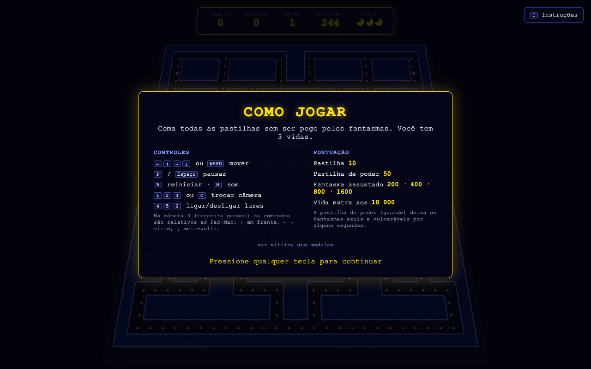
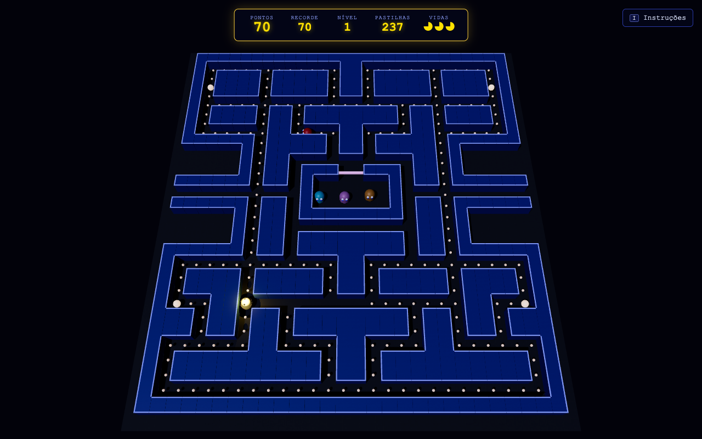
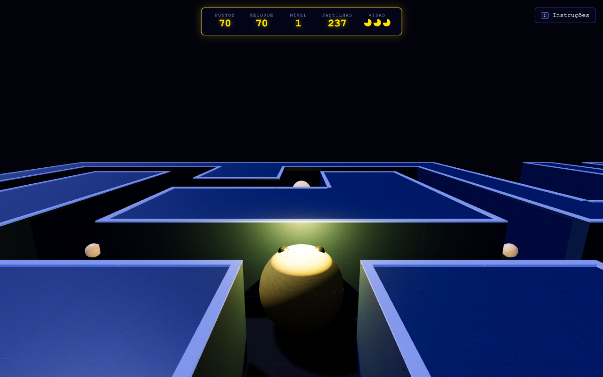
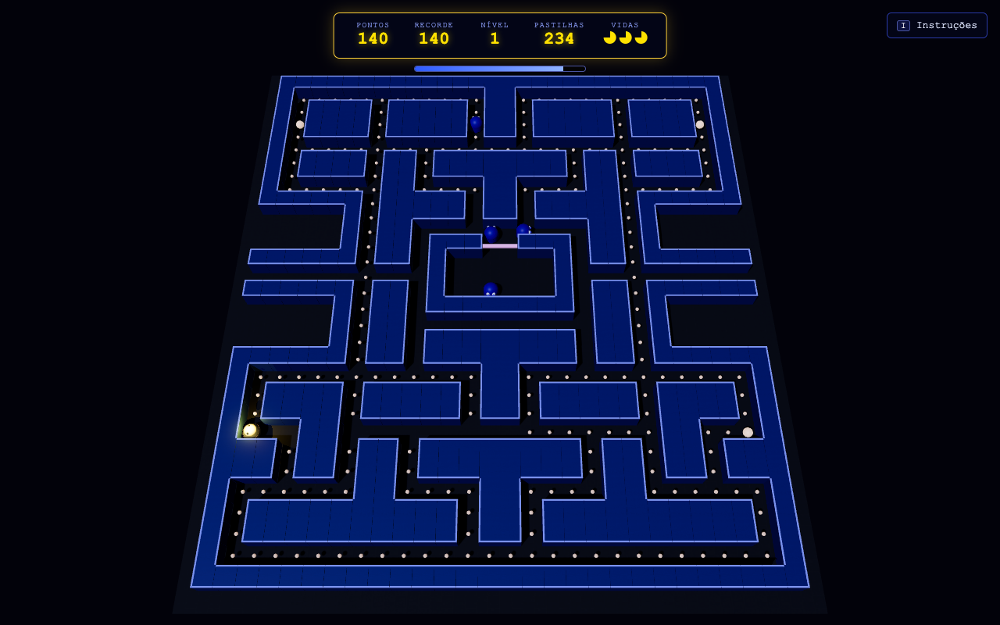
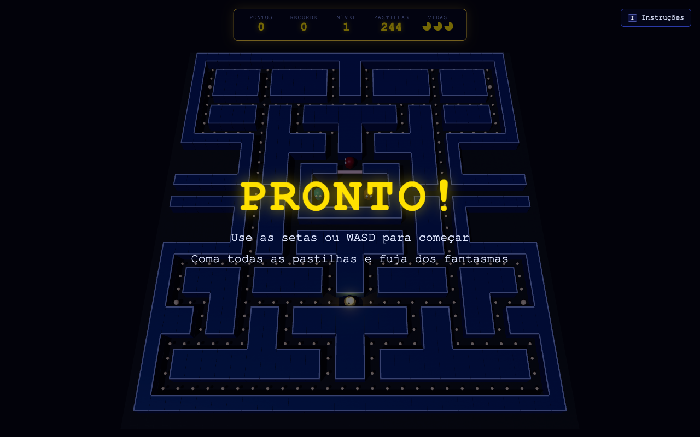
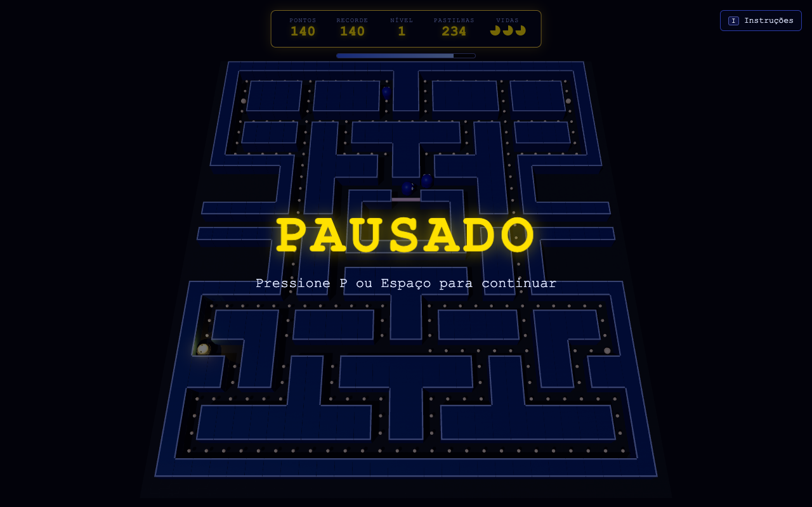
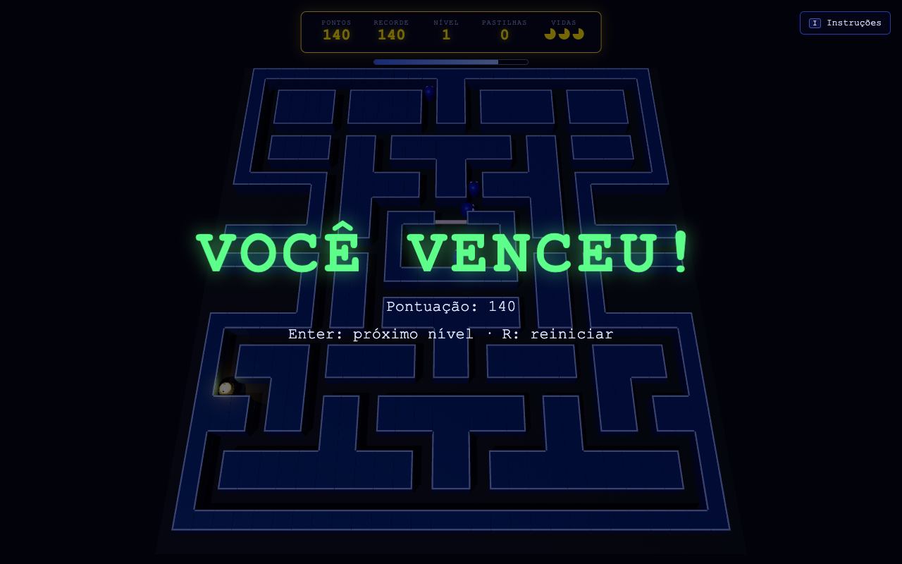
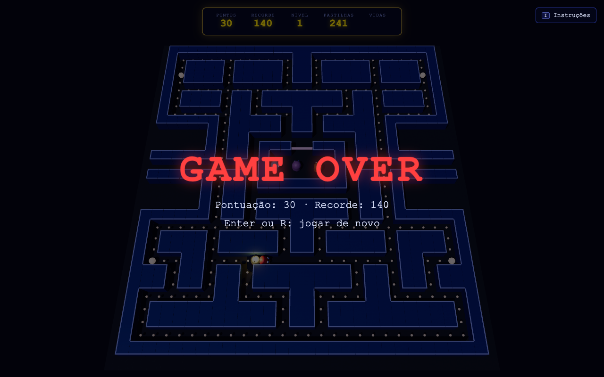

# Relatório — Entrega 05: Jogabilidade, interação e pontuação

**Projeto:** Pac-Man 3D
**Tecnologia:** Three.js r160 (WebGL), com HTML e módulos ES, sem etapa de build
**Branch:** `entrega-05-jogabilidade`
**Como executar:** `python3 -m http.server 8000` na pasta do projeto e abrir `http://localhost:8000` (é preciso internet para baixar o three.js do CDN)

## 1. Evolução em relação à Entrega 04

Até a Entrega 04 a cena era estática: modelos, câmeras, luzes e texturas, sem nenhuma regra de jogo. Nesta entrega o projeto virou um jogo jogável. A parte visual (modelos, câmeras, luzes e texturas) foi mantida e só recebeu ganchos para animação.

| | Entrega 04 | Entrega 05 |
|---|---|---|
| Pac-Man | Parado na posição inicial | **Controlado pelo jogador** (setas ou WASD), com a boca animada |
| Fantasmas | Parados | **IA própria**: perseguir, dispersar, assustados e comidos |
| Pastilhas | Decorativas | **Coletáveis**: somem ao serem comidas e dão pontos |
| Colisão | Não havia | Contra as paredes (grade) e entre Pac-Man e fantasmas |
| Pontuação | Não havia | Pontos, recorde, vidas, nível e pastilhas restantes na tela |
| Fim de jogo | Não havia | **Vitória**, **derrota (game over)** e reinício |
| Interface | Painel de câmera e luzes | Placar, mensagens de estado, tela de instruções e barra do poder |
| Som | Não havia | Efeitos sonoros sintetizados (Web Audio, sem arquivos) |

## 2. Proposta do jogo e mecânicas

O jogo segue a proposta inicial: um Pac-Man em labirinto 3D. O jogador deve **comer todas as pastilhas** sem ser pego pelos quatro fantasmas. As quatro pastilhas de poder invertem a situação por alguns segundos, e o jogador pode então caçar os fantasmas. Ele começa com 3 vidas.

### 2.1 Movimentação e controles

| Tecla | Ação |
|---|---|
| `←` `↑` `→` `↓` ou `A` `W` `D` `S` | Move o Pac-Man |
| `P` / `Espaço` | Pausa / continua |
| `R` | Reinicia a partida |
| `Enter` | Começa / próximo nível (após vencer) / jogar de novo (após game over) |
| `I` (ou o botão **Instruções**) | Mostra/esconde as instruções |
| `M` | Liga/desliga o som |
| `1` `2` `3` / `C` | Trocam a câmera (Entrega 03) |
| `4` `5` `6` | Ligam/desligam as luzes (Entrega 03) |

- O Pac-Man anda sozinho em linha reta e **vira nas esquinas** quando a direção pedida estiver livre. A direção fica guardada até a próxima esquina (*buffer* de curva), o que deixa o controle responsivo mesmo com a tecla apertada um pouco antes. **Dar meia-volta** funciona a qualquer momento.
- Na **câmera 3 (terceira pessoa)** os comandos são relativos ao personagem: `↑` segue em frente, `←` e `→` viram à esquerda e à direita dele e `↓` dá meia-volta.
- **Túnel lateral:** sair por um lado do labirinto leva ao lado oposto.
- A velocidade usa o tempo real de cada quadro (`dt`), então o jogo roda igual em qualquer taxa de FPS. O `dt` é limitado a 50 ms para evitar saltos depois de travadas.
- O Pac-Man gira suavemente para a direção do movimento e a boca abre e fecha enquanto ele anda. A câmera de terceira pessoa acompanha essa rotação.
- **Ações do jogo:** coletar (pastilhas) e desviar/fugir dos fantasmas; com a pastilha de poder, o jogador passa a **atacar** os fantasmas encostando neles. Pular e disparar não fazem parte da proposta de um Pac-Man.

| Tela de instruções (ao abrir o jogo ou com `I`) | Jogando (câmera 1) |
|---|---|
|  |  |



### 2.2 Interações, colisão e regras

**Colisão com as paredes.** O labirinto é uma grade (`MAZE_LAYOUT`). O movimento acontece entre centros de células e só entra numa célula livre (`advance()` em `src/game/Movement.js`). Assim ninguém atravessa parede, e não é preciso testar colisão geométrica a cada quadro.

**Coleta de pastilhas.** Ao passar por uma célula, a pastilha sai do estado do jogo e do cenário 3D. As pastilhas comuns são uma `InstancedMesh`, e a comida é escondida com escala zero (`Maze.hidePellet()`). As de poder pulsam para chamar a atenção.

**Colisão entre Pac-Man e fantasmas.** É um teste de proximidade: distância entre os centros menor que 0,7 célula (`#checkCollisions()` em `src/game/Game.js`). O resultado depende do estado do fantasma:

| Situação | Consequência |
|---|---|
| Fantasma normal encosta no Pac-Man | Perde 1 vida, toca a animação de morte e a rodada recomeça (pastilhas e pontos permanecem) |
| Fantasma assustado encosta no Pac-Man | O fantasma é comido: só os olhos voltam à casa, onde ele renasce e sai de novo |
| Pac-Man come pastilha de poder | Fantasmas ficam azuis, invertem o sentido e passam a fugir de forma aleatória por cerca de 7 s; piscam nos 2 s finais |

**Inteligência dos fantasmas.** Em cada cruzamento o fantasma escolhe, entre os caminhos livres (sem dar meia-volta), o que chega mais perto do seu alvo. Eles alternam entre **dispersar** (cada um vai para um canto do mapa) e **perseguir**, com os tempos do jogo original (7 s, 20 s, 7 s, 20 s, 5 s, 20 s, 5 s e depois só perseguem). A cada troca de modo, invertem o sentido. Cada um tem a sua personalidade:

| Fantasma | Alvo ao perseguir |
|---|---|
| Blinky (vermelho) | O próprio Pac-Man |
| Pinky (rosa) | 4 células à frente do Pac-Man (emboscada) |
| Inky (ciano) | O reflexo da posição de Blinky em torno de 2 células à frente do Pac-Man |
| Clyde (laranja) | O Pac-Man, se estiver a mais de 8 células; senão, foge para o seu canto |

Os fantasmas saem da casa em tempos diferentes (0, 2, 5 e 8 s). Os que foram comidos voltam à casa pelo caminho mais curto, calculado por busca em largura (BFS) sobre a grade. Dentro dos túneis laterais eles ficam mais lentos.

**Dificuldade crescente.** A cada nível, a velocidade sobe 5% e o efeito da pastilha de poder dura 1 s a menos (mínimo de 2,5 s).

### 2.3 Sistema de pontuação

| Evento | Pontos |
|---|---|
| Pastilha comum | 10 |
| Pastilha de poder | 50 |
| Fantasma comido, em sequência com o mesmo poder | 200 → 400 → 800 → 1600 |
| Vida extra | Ao atingir 10 000 pontos |

A pontuação é atualizada a cada evento e aparece no **placar no topo da tela**: pontos, recorde, nível, pastilhas restantes e vidas. O placar dá um pequeno "pulo" quando os pontos mudam. Os pontos de cada fantasma comido aparecem flutuando sobre ele (`+200`, `+400` ...). Enquanto o poder está ativo, uma **barra de tempo** aparece sob o placar. O **recorde** fica salvo no navegador (`localStorage`).



### 2.4 Objetivo, vitória, derrota e reinício

| Estado | Como se chega | Mensagem | Saída |
|---|---|---|---|
| **Pronto** | Ao abrir o jogo (depois das instruções) e a cada recomeço de rodada | "PRONTO!" | Qualquer seta inicia |
| **Pausado** | `P` ou `Espaço`; também ao trocar de aba ou abrir as instruções | "PAUSADO" | `P` ou `Espaço` |
| **Vitória** | Todas as pastilhas comidas | "VOCÊ VENCEU!" com a pontuação | `Enter` vai para o próximo nível (mais rápido, mantendo os pontos); `R` reinicia |
| **Derrota** | As 3 vidas acabam | "GAME OVER" com pontuação e recorde | `Enter` ou `R` jogam de novo |

`R` reinicia a partida a qualquer momento.

| Pronto | Pausado |
|---|---|
|  |  |

| Vitória | Game over |
|---|---|
|  |  |

## 3. Arquitetura

A lógica do jogo não depende do three.js: `Game.js` guarda e atualiza o estado, e `main.js` só lê esse estado e o desenha. Isso permitiu testar as regras no Node, sem navegador.

```
CgGame/
├── index.html            placar, mensagens, instruções e botão "I"
├── css/style.css         estilos do placar, das mensagens e das instruções
├── tests/game.test.mjs   testes automáticos da lógica (node --test tests/)
├── docs/                 relatórios e capturas
└── src/
    ├── main.js           (alterado) controles, HUD, sincronização com a cena 3D e loop
    ├── game/             (novo)
    │   ├── Game.js       regras: estado, pontuação, vidas, IA dos fantasmas, vitória/derrota
    │   ├── Movement.js   grade, colisão com paredes, túnel e BFS de distâncias
    │   └── Sfx.js        efeitos sonoros (Web Audio)
    ├── scene/Maze.js     (alterado) esconder/restaurar pastilhas, animação das de poder
    └── models/           (alterado) expõem mandíbulas e material para a animação
```

Fluxo de cada quadro (`renderer.setAnimationLoop` em `main.js`): `game.update(dt)` → `handleEvents()` (som, pastilhas sumindo, pontos flutuantes) → `syncScene()` (posição, rotação, cor e animação dos modelos) → `renderHud()` → atualização das câmeras → `render`.

## 4. Testes

Os testes ficam em `tests/game.test.mjs` e rodam com `node --test tests/`. Os 7 passam:

1. O Pac-Man anda e não atravessa parede.
2. Comer pastilhas aumenta a pontuação (10 por pastilha).
3. A pastilha de poder assusta os fantasmas e o primeiro fantasma comido vale 200.
4. Encostar num fantasma tira uma vida, e o jogo acaba quando as vidas zeram.
5. Comer a última pastilha vence.
6. Simulação de 2 minutos com entradas aleatórias: ninguém entra em parede, nenhuma posição fica inválida e todos os fantasmas saem da casa.
7. O túnel teletransporta de um lado ao outro.

As capturas deste relatório foram geradas do jogo real rodando no Chrome, controlado por script (teclas reais e leitura do estado).

## 5. Roteiro da demonstração (vídeo)

1. Abrir o jogo: mostrar a tela de instruções, fechar com uma tecla e ver o "PRONTO!". Mostrar que `I` abre e fecha as instruções.
2. Iniciar com as setas: mostrar o movimento, a boca animada, as curvas nas esquinas, a colisão com a parede e o túnel lateral.
3. Comer pastilhas: o placar sobe e as pastilhas somem.
4. Trocar de câmera (`1`, `2`, `3`) e mostrar os controles relativos na terceira pessoa.
5. Comer uma pastilha de poder: fantasmas azuis, barra de tempo, comer fantasmas com os pontos dobrando (`+200`, `+400` ...).
6. Ser pego por um fantasma: animação de morte e uma vida a menos. Repetir até o **GAME OVER**, e reiniciar com `R`.
7. Mostrar a **vitória**: digitar `demoVitoria()` no console do navegador (deixa só as 3 pastilhas mais próximas) e comê-las. `Enter` leva ao nível 2.
8. Mostrar `P` (pausa) e `M` (som).
9. Mostrar rapidamente `src/game/Game.js` (regras e IA) e `src/game/Movement.js` (colisão).

## 6. Dificuldades

1. **Colisão com paredes sem "grudar".** Testar a posição contínua contra as paredes fazia o Pac-Man prender nas quinas. Passamos a mover entre centros de células da grade, o que também permite guardar a próxima curva e dá um controle bem mais fluido.
2. **Fantasmas saindo e voltando à casa.** A porta da casa bloqueia o Pac-Man, mas precisa estar livre para os fantasmas. Criamos a opção `canDoor` na navegação e dois campos de distância (BFS), um até a saída e outro até o centro da casa. Houve ainda um bug em que o fantasma passava pelo alvo sem "perceber" e saía andando pelo mapa ainda no estado de saída. A correção foi detectar o fim da saída pela posição e tratar a chegada do fantasma comido dentro da função de decisão de direção.
3. **Separar regras e desenho.** Manter `Game.js` sem three.js permitiu os testes automáticos e deixou a cena apenas "espelhar" o estado. Para isso, o cenário e os modelos ganharam métodos e ganchos (esconder pastilhas, mandíbulas e material dos fantasmas).
4. **Pastilhas instanciadas.** As pastilhas comuns são uma única `InstancedMesh` (1 draw call). Para "comer" uma, escondemos a instância com escala zero, e guardamos as matrizes originais para restaurá-las no novo nível.
5. **Painel de câmera e luzes cobrindo o placar.** O painel da Entrega 03 sobrepunha o placar. Ele foi escondido e as instruções passaram para uma tela própria, aberta por `I` ou pelo botão no canto superior direito. As teclas de câmera e luz continuam funcionando.
6. **Controles na terceira pessoa.** Com a câmera atrás do personagem, as setas "da tela" confundem. Nessa câmera os comandos passaram a ser relativos ao Pac-Man.

## 7. Requisitos da entrega

| Requisito | Onde está |
|---|---|
| Controles e movimentação do personagem | Seção 2.1 · `Game.#updatePacman`, `Movement.advance` |
| Ações necessárias (coletar, desviar, atacar fantasmas) | Seções 2.1 e 2.2 |
| Controles respondem adequadamente | *Buffer* de curva, meia-volta imediata, controles relativos na câmera 3 |
| Interações personagens × cenário | Seção 2.2 · pastilhas, paredes, porta e túnel |
| Colisão e proximidade | Seção 2.2 · grade para as paredes e distância para os fantasmas |
| Regras e consequências | Seção 2.2 · tabela de consequências |
| Pontuação coerente, atualizada e visível | Seção 2.3 · placar, pontos flutuantes e barra do poder |
| Vitória e derrota claras, com reinício | Seção 2.4 |
| Vídeo de demonstração | Roteiro na seção 5 |
| Fontes atualizados e recursos para executar | Este repositório, branch `entrega-05-jogabilidade` (README com instruções) |

## 8. Próximos passos

- Fruta bônus no centro do labirinto e velocidades diferentes por nível.
- Ajuste fino da inteligência dos fantasmas e da dificuldade.
- Mais efeitos visuais (partículas ao comer) e uma tela de menu inicial.
